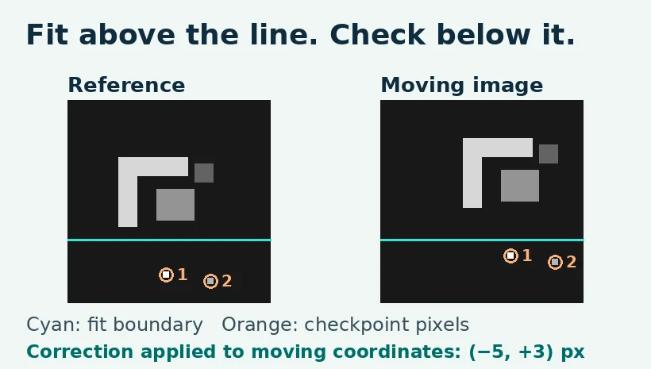

# Image Registration: Align Two Frames in Python

Use phase correlation to estimate how to move one small grayscale image onto another. Check that correction against two marks outside the fitting crop before accepting it. The examples are synthetic and run offline. The full [WIFA Robotics lesson](https://wifarobotics.com/learn/image-registration-tutorial/) explains the coordinates, the math and how to design a physical camera check.

## Start from zero

1. Install [Python 3.12 or later](https://www.python.org/downloads/). Check `python3 --version` on macOS/Linux or `py -3 --version` on Windows. If Windows cannot find the launcher but `python --version` works, use `python` in place of `python3`.
2. Download this repository as a ZIP from the green **Code** menu and extract it. Open a terminal in the folder containing `register.py`. There are no runtime packages to install.
3. Run the commands below. On Windows substitute `py -3` for `python3`.

```sh
python3 register.py examples/shifted.json
python3 register.py examples/lighting-offset.json
python3 register.py examples/local-motion.json
python3 register.py examples/out-of-range.json
python3 register.py examples/repeated.json
python3 -m unittest discover -s tests -v
```

| Example | Exit | Expected result |
| --- | ---: | --- |
| shifted | 0 | Correction (−5, +3) px; residuals 0, 0 px; 76.46% full frame overlap |
| lighting offset | 0 | Same correction and residuals after adding three gray levels without clipping |
| local motion | 1 | Same peak and correction; residuals 3, 0 px; reject |
| out of range | 1 | Measured horizontal correction is 5 px in magnitude; declared limit is 4 px |
| repeated | 1 | Equal peaks; no correction returned |

A malformed input gives exit 2 and writes a message to stderr. Exit 1 is an expected decision for a rejected estimate. Python's test runner checks both types of rejection.



## Input and output

Write the accepted alignment with `python3 register.py examples/shifted.json --aligned-out aligned.pgm`. Use a new filename; the program will not replace an existing file or save a rejected alignment. This raster uses black for pixels exposed at the border, so do not treat the black fill as a measured intensity.

Edit a copy of a JSON file under `examples/`. The two paths are relative to that JSON file. Both files must be same sized plain P2 PGM images, 4 to 64 pixels per side, with gray values 0 to 255 and maxval 255. The practical minimum height is 5 because at least four fitting rows and a separate lower region are required. Coordinates are zero based `[x,y]` with x to the right and y down. Give at least two distinct matching checkpoint pairs below `fit_height_px` in both images. Set the largest plausible per axis shift before fitting; keep it below half the shorter fitting dimension. The distance limit for each checkpoint is Euclidean in pixels.

Add `correction_xy_px` to moving coordinates. The reported overlap is geometric overlap of the two full rectangles after integer translation, excluding wrapped coordinates. It does not identify shared scene content or certify agreement over that area. Peak gap is a score difference in the Fourier correlation surface, not a probability or tolerance. The 0.05 guard is illustrative.

## Troubleshooting and extension

- File not found: use the folder that contains `register.py` and keep the PGM files next to their manifest.
- Wrong raster: P5 is binary PGM, which this parser does not read. Use P2 with the dimensions and maxval supported by this lab.
- Ambiguous peak: replace repeated texture with a unique asymmetric feature and keep it visible in both fitting crops.
- Checkpoint mismatch: verify mark identity and coordinate order. If the marks really move differently, do not use a single translation.
- Try an experiment: copy `shifted.json` and change only its shift limit to 4. The estimated correction stays the same and the decision changes.

`examples/generate.py` regenerates the bundled synthetic inputs. `diagrams/render.py` regenerates the WebPs using Pillow 10.1+ in a separate environment if you want to edit the artwork. The estimation code uses a slow, readable discrete transform for tiny images. It has no camera interface and does not estimate rotation, scale, distortion or fractional shifts. For real hardware, measure repeatability across independent images and confirm held out checks throughout the working area. Never connect a synthetic acceptance flag to robot motion.

Reference: [OpenCV phase correlation](https://docs.opencv.org/doc/doxygen/html/d7/df3/group__imgproc__motion.html), [scikit-image registration and periodic ambiguity](https://scikit-image.org/docs/stable/api/skimage.registration.html), and [Netpbm PGM](https://netpbm.sourceforge.net/doc/pgm.html).
